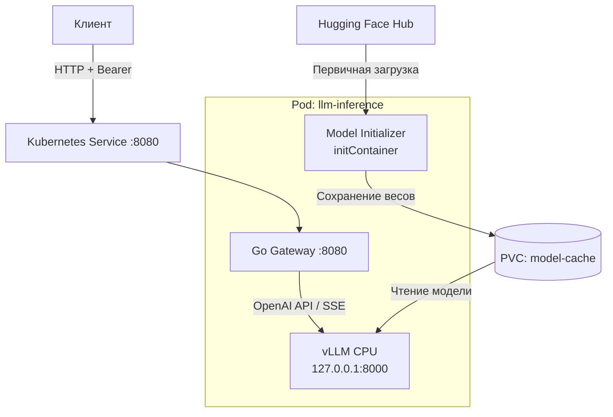

# CPU-инференс LLM в Kubernetes

Сервис инференса языковой модели на CPU с OpenAI-совместимым API, Bearer-аутентификацией и постоянным хранением весов.

В системе используются **vLLM 0.32.0 CPU**, **Qwen2.5-1.5B-Instruct**, API Gateway на Go и Kubernetes. Для локального развёртывания предусмотрены Minikube и Kustomize.

## Документация

- [Архитектура](docs/architecture.md) — компоненты, ответственность, безопасность и последовательности взаимодействий.
- [Бенчмаркинг](docs/benchmark.md) — методика, TTFT, latency, throughput и анализ.
- [Результаты измерений](docs/benchmark-results.json) — исходные данные в JSON.

## Архитектура



Deployment содержит один Pod с двумя постоянно работающими контейнерами и одним initContainer. Инициализатор подготавливает модель до запуска основных контейнеров.

**Gateway — единственная точка доступа к inference API.** vLLM слушает `127.0.0.1:8000` внутри Pod и не публикуется отдельным Kubernetes Service.

Модель хранится на PersistentVolumeClaim: инициализатор монтирует том для записи, vLLM — только для чтения.

### Компоненты

| Компонент | Ответственность |
| --- | --- |
| Go Gateway | Bearer-аутентификация, проксирование HTTP, передача SSE, журналирование метаданных |
| vLLM CPU | Загрузка модели, обработка запросов, генерация текста |
| Model Initializer | Загрузка закреплённой ревизии модели и проверка локальных файлов |
| PVC | Сохранение весов между перезапусками Pod |
| ConfigMap | Параметры модели и инференса |
| Secret | API-токен и необязательный Hugging Face токен |
| Kubernetes | Порядок запуска, размещение, probes и управление жизненным циклом |

Подробности и sequence-диаграммы приведены в [описании архитектуры](docs/architecture.md).

## Жизненный цикл модели

**Первый запуск:** initContainer получает идентификатор модели и её ревизию из ConfigMap, скачивает файлы из Hugging Face Hub, проверяет их и сохраняет на PVC. Только после успешного завершения инициализации Kubernetes запускает vLLM и Gateway.

**Повторный запуск:** initContainer проверяет сохранённую модель и пропускает скачивание, если файлы соответствуют конфигурации. vLLM загружает веса непосредственно с PVC.

PVC устраняет повторную сетевую загрузку, но не отменяет загрузку модели в оперативную память и подготовку CPU inference engine после перезапуска процесса.

## Структура репозитория

```text
gateway/             Go API Gateway, тесты и Dockerfile
inference/           Dockerfile, requirements.txt, logging.json
model-initializer/   Загрузчик модели, тесты, зависимости и Dockerfile
k8s/base/            Namespace, ConfigMap, PVC, Deployment, Service, Kustomize
scripts/             Вспомогательные инструменты и benchmark.py
docs/                Архитектура и результаты бенчмаркинга
secrets/             Локальные учётные данные, исключённые из Git
```

## Системные требования

- Linux или WSL2;
- Docker Engine;
- Minikube с Docker driver;
- Kubernetes CLI (достаточно `minikube kubectl --`);
- доступ к Hugging Face Hub при первой загрузке весов;
- CPU и оперативная память для выбранной модели.

GPU не требуется.

Проверенное окружение:

| Параметр | Значение |
| --- | --- |
| vLLM | 0.32.0, CPU |
| Модель | Qwen/Qwen2.5-1.5B-Instruct |
| Kubernetes | Minikube |
| Container runtime | containerd |
| Конфигурация CPU | 12 vCPU |
| Лимит памяти Minikube | 14 GiB |
| Размер PVC | 10 GiB |
| Максимальная длина контекста | 2048 токенов |

Приведённые значения описывают тестовое окружение; они не являются универсальными минимальными требованиями.

## Сборка

Все команды выполняются из корня репозитория.

```bash
docker build \
  -t llm-inference-vllm:local \
  -f inference/Dockerfile inference

docker build \
  -t llm-inference-model-initializer:local \
  -f model-initializer/Dockerfile model-initializer

docker build \
  -t llm-inference-gateway:local \
  -f gateway/Dockerfile gateway
```

### Воспроизводимость Python-окружения

Базовый CPU-образ vLLM закреплён по SHA256 digest в `inference/Dockerfile`.

Файл `inference/requirements.txt` содержит точный список установленных Python-пакетов, включая транзитивные зависимости. Во время сборки Dockerfile сравнивает его с фактическим выводом `pip freeze` базового образа:

```dockerfile
RUN python -m pip freeze | diff -u /opt/vllm/requirements.txt -
```

Несовпадение приводит к ошибке сборки.

CPU-сборка vLLM и её локальный wheel поставляются в закреплённом базовом образе; зависимости не устанавливаются повторно из PyPI.

Закреплённая ревизия модели также задаётся в ConfigMap.

## Развёртывание

### 1. Запуск Minikube

Для нового кластера:

```bash
minikube start --driver=docker --cpus=12 --memory=14336
```

Параметры CPU и памяти выбираются в соответствии с возможностями хоста. Размер памяти существующего кластера с Docker driver нельзя изменить через повторный `minikube start --memory`.

### 2. Загрузка образов

```bash
minikube image load llm-inference-vllm:local
minikube image load llm-inference-model-initializer:local
minikube image load llm-inference-gateway:local
```

Манифесты используют `imagePullPolicy: Never`, поэтому образы должны быть доступны внутри Minikube до развёртывания.

### 3. Namespace и API-токен

```bash
minikube kubectl -- apply -f k8s/base/Namespace.yaml

mkdir -p secrets
chmod 700 secrets
umask 077

openssl rand -hex 32 | tr -d '\n' > secrets/api-token
```

Токен содержит 64 шестнадцатеричных символа без завершающего перевода строки.

Создание Kubernetes Secret:

```bash
minikube kubectl -- create secret generic vllm-secrets \
  -n llm-inference \
  --from-file=API_KEY=secrets/api-token \
  --dry-run=client -o yaml \
  | minikube kubectl -- apply -f -
```

Используемая модель публичная и не требует Hugging Face токена. Для gated-модели initContainer поддерживает необязательный ключ `HF_TOKEN` в том же Secret.

Секреты не должны добавляться в Git.

### 4. Применение манифестов

```bash
minikube kubectl -- apply -k k8s/base

minikube kubectl -- rollout status \
  deployment/llm-inference \
  -n llm-inference \
  --timeout=600s

minikube kubectl -- get pods -n llm-inference
```

После завершения инициализации ожидается Pod в состоянии `2/2 Running`.

## Проверка API

Пробросить порт Service на локальную машину:

```bash
minikube kubectl -- port-forward \
  -n llm-inference \
  service/llm-inference 8080:8080
```

Следующие команды выполняются в другом терминале из корня репозитория.

### Проверка состояния

```bash
curl -i http://127.0.0.1:8080/healthz
```

Ожидается HTTP 200.

### Проверка Bearer-аутентификации

Без токена:

```bash
curl -i http://127.0.0.1:8080/v1/models
```

Ожидается HTTP 401.

С токеном:

```bash
curl -i \
  -H "Authorization: Bearer $(cat secrets/api-token)" \
  http://127.0.0.1:8080/v1/models
```

Ожидается HTTP 200 и информация о модели.

### Генерация текста

```bash
curl -N --max-time 120 \
  http://127.0.0.1:8080/v1/chat/completions \
  -H "Authorization: Bearer $(cat secrets/api-token)" \
  -H "Content-Type: application/json" \
  -d '{
    "model": "Qwen/Qwen2.5-1.5B-Instruct",
    "messages": [
      {"role": "user", "content": "Say hello."}
    ],
    "max_tokens": 8,
    "temperature": 0,
    "stream": true
  }'
```

При успешном streaming-запросе Gateway передаёт SSE-события и завершающее `data: [DONE]`.

## Конфигурация

`k8s/base/ConfigMap.yaml` задаёт основные параметры:

| Переменная | Назначение |
| --- | --- |
| `MODEL_ID` | Идентификатор модели |
| `MODEL_REVISION` | Закреплённая ревизия весов |
| `MODEL_PATH` | Путь хранения модели |
| `MAX_MODEL_LEN` | Максимальная длина контекста |
| `MEMORY_UTILIZATION` | Доля памяти для CPU backend |

Secret `vllm-secrets` содержит ключ `API_KEY` и при необходимости `HF_TOKEN`.

Deployment использует одну реплику и стратегию `Recreate`. При перезапуске API временно недоступен, пока vLLM снова не пройдёт инициализацию.

## Безопасность и логирование

Контейнеры запускаются от непривилегированных пользователей. Kubernetes security contexts запрещают повышение привилегий и сбрасывают дополнительные Linux capabilities.

Внешний клиент обращается к модели исключительно через Gateway. Bearer-аутентификация выполняется до передачи запроса в vLLM.

Gateway журналирует метаданные HTTP-запросов без тел сообщений. Конфигурация `inference/logging.json` ограничивает логирование vLLM и заменяет access-записи безопасным сообщением:

```text
INFO inference_request
```

Access-записи для `/health` и `/metrics` отфильтрованы. Проверки готовности Kubernetes не создают событий `inference_request`.

Поведение проверено на успешном streaming-запросе с уникальным контрольным маркером: запрос завершился с HTTP 200, создал одну новую access-запись, а маркер отсутствовал в логах обоих контейнеров.

## Обновление и повторный запуск

Модель сохраняется на PVC после завершения Pod. Для повторного запуска:

```bash
minikube kubectl -- rollout restart \
  deployment/llm-inference -n llm-inference
```

InitContainer использует существующие веса, если их идентификатор, ревизия и набор файлов соответствуют конфигурации.

В Deployment предусмотрена аннотация Stakater Reloader:

```yaml
reloader.stakater.com/auto: "true"
```

При установленном контроллере обновление используемого ConfigMap или Secret инициирует перезапуск Pod. Само приложение не зависит от наличия Reloader.

## Бенчмаркинг

Скрипт `scripts/benchmark.py` измеряет время до первого содержательного токена, полную задержку и скорость декодирования.

Для запуска необходим работающий port-forward:

```bash
python3 -u scripts/benchmark.py
```

Для короткого и длинного промптов выполняются прогрев и пять последовательных измерений. Результаты записываются в `docs/benchmark-results.json`.

Методика, фактические показатели и ограничения интерпретации приведены в [отчёте](docs/benchmark.md).

## Итоговые результаты бенчмарка

Запуск: `python3 -u scripts/benchmark.py`.

Медианные значения пяти измерений после прогрева:

| Метрика | Короткий промпт | Длинный промпт |
|---|---:|---:|
| Входные токены | 40 | 1828 |
| Выходные токены | 48 | 64 |
| TTFT | 169,4 мс | 189,8 мс |
| Latency | 4,30 с | 5,80 с |
| Decode throughput | 11,38 ток/с | 11,23 ток/с |

Тесты выполнены последовательно на CPU. Decode throughput отражает
скорость генерации одного запроса, а не суммарную пропускную способность
при конкурентной нагрузке.

Подробности: [Методика и анализ](docs/benchmark.md).
