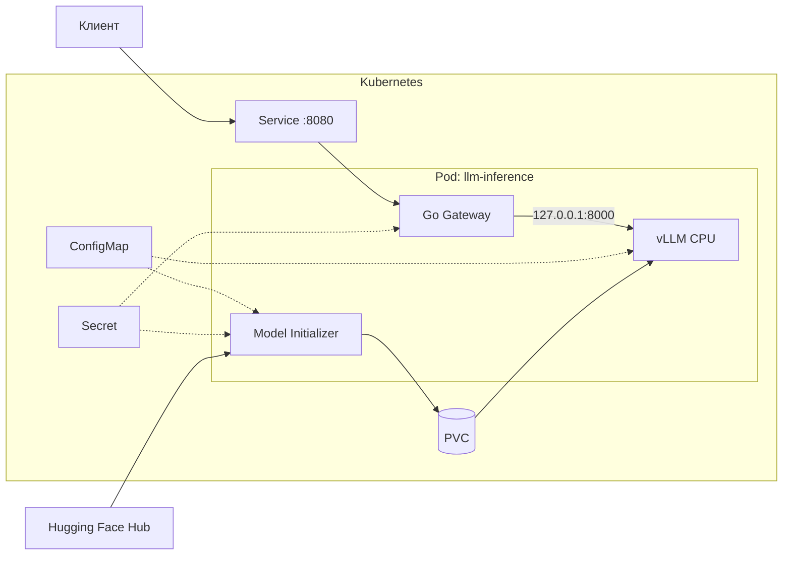
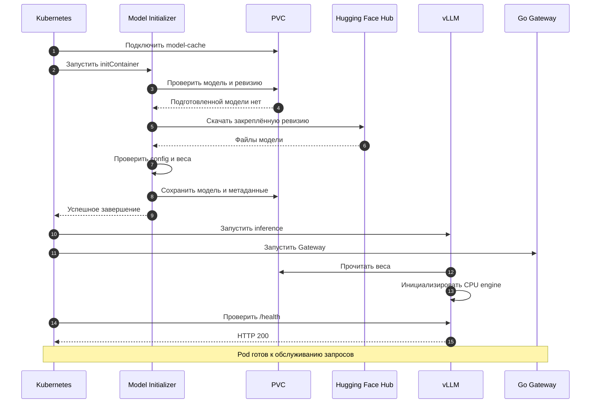
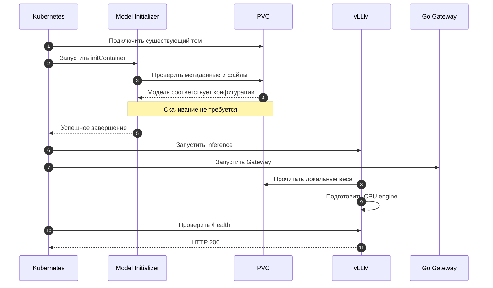
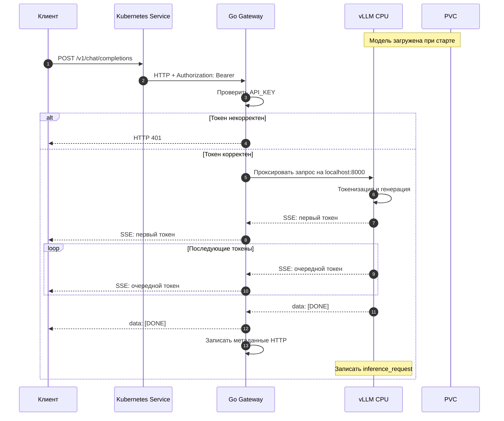

# Архитектура системы

## Назначение

Система предоставляет OpenAI-совместимый API инференса языковой модели на CPU в Kubernetes.

Архитектура разделяет подготовку модели, выполнение инференса и обработку клиентского HTTP-трафика. Компоненты имеют отдельные обязанности и не дублируют функции друг друга.

## Компоненты и границы ответственности



### Клиент и Service

Клиент использует OpenAI-совместимые HTTP endpoints.

Kubernetes Service публикует порт `8080` внутри кластера и направляет трафик в Go Gateway. Для локального доступа применяется `kubectl port-forward`.

Service не обращается к vLLM напрямую.

### Go Gateway

Gateway выполняет проверку Bearer-токена, принимает HTTP-запросы и проксирует их в vLLM.

При потоковой генерации Gateway передаёт Server-Sent Events по мере поступления, не накапливая полный ответ перед отправкой клиенту.

Gateway логирует метод, статус, длительность и идентификатор запроса. Содержимое промптов и генерации в журнал не включается.

### vLLM CPU

vLLM загружает подготовленную модель с PVC и предоставляет OpenAI-совместимый API.

Процесс слушает `127.0.0.1:8000`, поэтому доступен Gateway внутри того же Pod, но не публикуется отдельным Kubernetes Service.

Основные параметры инференса передаются из ConfigMap.

### Model Initializer

Инициализатор выполняется в Kubernetes как initContainer.

Он сопоставляет модель на PVC с ожидаемым идентификатором и закреплённой ревизией. При наличии корректных файлов сетевое скачивание пропускается.

При необходимости инициализатор скачивает модель из Hugging Face Hub, проверяет наличие обязательных файлов, сохраняет модель на PVC и фиксирует метаданные успешной инициализации.

Основные контейнеры запускаются только после успешного завершения initContainer.

### Хранение модели

PVC `model-cache` хранит файлы модели независимо от жизненного цикла Pod.

Инициализатор использует том в режиме чтения и записи. vLLM подключает модель в режиме только чтения.

Использование одной реплики и стратегии Deployment `Recreate` упрощает работу с томом `ReadWriteOnce`.

## Последовательность 1. Первичная загрузка модели



Загрузка модели выполняется до запуска основных контейнеров и не требует отдельного публичного сервиса.

Закреплённая ревизия исключает неявный переход на новые веса при последующих установках.

## Последовательность 2. Повторный запуск



Повторное использование PVC экономит сетевой трафик и время скачивания. При этом создание нового процесса vLLM по-прежнему требует загрузки весов в RAM и инициализации вычислительного окружения.

## Последовательность 3. Авторизованный streaming-запрос



Аутентификация выполняется до передачи запроса inference-серверу.

Gateway сохраняет потоковую семантику ответа. Клиент начинает получать результат до завершения генерации.

## Безопасность

### Сетевые границы

- Клиентский трафик поступает на Kubernetes Service и далее в Gateway.
- vLLM принимает подключения только внутри Pod через loopback.
- Порт vLLM не публикуется отдельным Service.
- Hugging Face Hub используется инициализатором только тогда, когда требуется загрузка модели.

### Привилегии

Контейнеры запускаются от непривилегированного UID.

Kubernetes security contexts запрещают повышение привилегий, удаляют дополнительные Linux capabilities и используют профиль seccomp `RuntimeDefault`.

Для контейнера инициализации и Gateway предусмотрена файловая система только для чтения с отдельными записываемыми томами там, где они необходимы.

### Секреты

`API_KEY` передаётся Gateway из Kubernetes Secret. Необязательный `HF_TOKEN` используется инициализатором.

Секреты не размещаются в ConfigMap и не записываются в журналы приложения.

### Логирование

В Gateway записываются только метаданные HTTP-запросов.

vLLM использует собственный `logging.json`. Access-лог сохраняет факт инференса, но не включает URL, тело запроса или текст ответа:

```text
INFO inference_request
```

Запросы `/health` и `/metrics` исключены из access-журнала с помощью `UvicornAccessLogFilter`.

Проверка на реальном streaming-запросе подтвердила, что контрольный маркер отсутствует в логах Gateway и vLLM, а успешный POST создаёт одну запись о запросе к inference API.

## Эксплуатационные свойства

### Готовность

Gateway имеет собственный endpoint `/healthz`.

Готовность vLLM проверяется через `/health` на `127.0.0.1:8000`. Во время загрузки модели startup probe допускает продолжительную инициализацию.

### Обновление

Deployment использует одну реплику и стратегию `Recreate`.

Во время обновления Pod сервис временно недоступен до завершения инициализации vLLM.

При установленном Stakater Reloader изменения ConfigMap и Secret автоматически инициируют обновление Pod. Reloader не участвует в обработке inference-запросов.

### Ресурсы

CPU-инференс требует оперативной памяти для весов модели, KV cache и вычислительного окружения.

Значение `MEMORY_UTILIZATION` управляет долей памяти, выделяемой backend vLLM. Лимиты Kubernetes и внешнего Docker-контейнера Minikube также должны соответствовать доступной памяти хоста.

### Масштабирование

Текущее развёртывание рассчитано на одну модель и одну реплику.

PVC с режимом `ReadWriteOnce` и стратегия `Recreate` обеспечивают простое управление жизненным циклом модели. Для нескольких реплик потребовалась бы отдельная схема хранения и распределения запросов.

## Производительность

Измерения выполнены через публичный интерфейс Gateway с использованием streaming API.

Сравнение короткого и длинного промптов, методика расчёта TTFT и скорости декодирования приведены в [отчёте о бенчмаркинге](benchmark.md).
